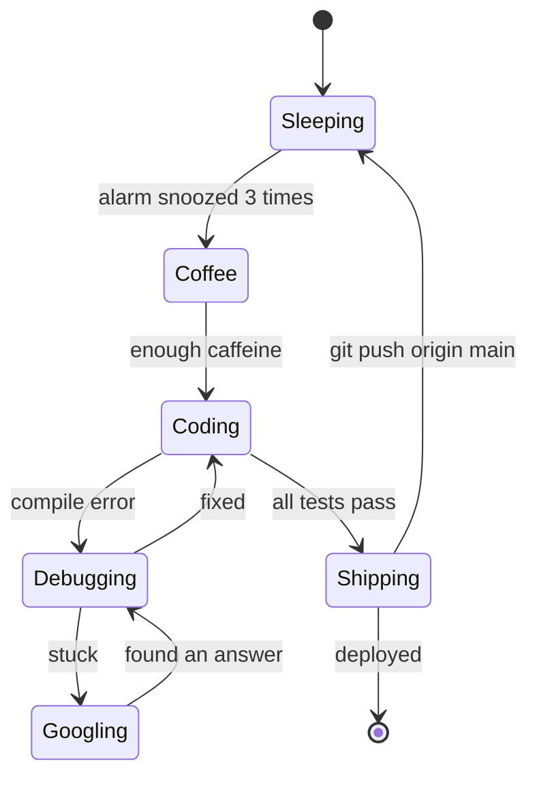

<div align="center">

# `B.Tech in Computer Science & Engineering`
### Sairam Lakshmanan · Batch of 2027

```
┌─────────────────────────────────────────────────────┐
│  $ ./boot_developer.sh                              │
│  [ OK ] Loading curiosity.ko                        │
│  [ OK ] Mounting /dev/coffee                        │
│  [WARN] sleep_scheduler: process starved            │
│  [ OK ] System ready. Welcome to my profile.        │
└─────────────────────────────────────────────────────┘
```

</div>


## 🧬 `class Developer`

```python
class Developer:
    def __init__(self):
        self.name       = "Sairam Lakshmanan"
        self.location   = "Chennai, Tamilnadu"
        self.focus      = ["Coding", "Debugging", "Learning"]
        self.fuel       = "[coffee]"
        self.motto      = "Code is temporary. Understanding is permanent."

    def solve(self, problem):
        while not problem.solved:
            try:
                self.think()
                self.code()
                self.test()
            except Bug:
                self.google()
                self.cry_a_little()
                continue
        return "git push origin main"
```


## ⏱️ Time Complexity of My Habits

| Habit | Complexity | Notes |
|---|---|---|
| Debugging without logs | `O(n!)` | Pure suffering |
| Debugging with `print()` | `O(n)` | Honest and reliable |
| Rubber-duck debugging | `O(log n)` | The duck always knows |
| Reading docs *before* coding | `O(1)` | Rarely executed |
| Copying from Stack Overflow | `O(1)` time, `O(n²)` regret | Cache miss on understanding |
| Naming variables | `O(∞)` | Never terminates |
| "Just one more commit" | `while(true)` | Infinite loop, no break condition |


## 🔄 My Daily Finite State Machine



---

## 🧮 Logic Gate: Will I Accept Your Collab?

**Formula:** `Accept = Interesting AND (OpenSource OR Chai)`

| Interesting idea? | Open source? | Chai / coffee? | **Result** |
|:---:|:---:|:---:|:---:|
| 0 | 0 | 0 | ❌ Reject |
| 0 | 0 | 1 | ❌ Reject (nice try) |
| 0 | 1 | 0 | ❌ Reject |
| 0 | 1 | 1 | ❌ Reject |
| 1 | 0 | 0 | ❌ Reject |
| 1 | 0 | 1 | ✅ Accept |
| 1 | 1 | 0 | ✅ Accept |
| 1 | 1 | 1 | ✅✅ Accept immediately |

---

## 🌐 Contact Me Using the OSI Model

Seven layers, one developer. Pick your layer.

| Layer | Name | How It Works for Me |
|:---:|---|---|
| **7** | Application | 📧 Email: sairamlakshmanan2005@gmail.com |
| **6** | Presentation | Short and clear messages. Markdown welcome, 40-slide decks not |
| **5** | Session | 📞 Book a call: https://calendly.com/sairamlakshmanan2005/30min |
| **4** | Transport | I reply within `[24 hours]`. TCP, not UDP: guaranteed delivery |
| **3** | Network | 💼 [LinkedIn] (https://www.linkedin.com/in/sairam-lakshmanan-29b883285) |
| **2** | Data Link | A mutual connection or referral works too |
| **1** | Physical | ☕ Meet in person in Chennai, Tamilnadu |

## ⚙️ Round-Robin Scheduler: How My Day Gets Split

```
Time Quantum = 2 hours
┌──────────┬──────────┬──────────┬──────────┬──────────┐
│  P1      │  P2      │  P3      │  P4      │  P1      │
│ [Project]│ [Learn]  │ [Open    │ [Gym /   │ [Project]│
│          │          │  Source] │  Walk]   │ (resumed)│
└──────────┴──────────┴──────────┴──────────┴──────────┘
 Context switches per day: [~12]   Cost: 1 coffee each
```

---

## 🌳 Skill Tree (Stored as a Binary Tree)

```
                Sairam Lakshmanan
                   /           \
          Languages             Tools
          /      \              /     \
    Python       Java       Git       Docker
   ████████░░  ██████░░░░   █████████░ ███████░░░
      80%         60%          90%        70%

   Traversal order: in-order (learned), post-order (shipped)
```

---

## 🏆 Achievements Unlocked

- [x] Wrote a program that worked on the first try *(once, never repeated)*
- [x] Fixed a bug caused by a missing semicolon after 3 hours
- [x] Solved 150+ coding problems on LeetCode
- [ ] Reach 100 days of consistent coding
- [ ] Understand why the code works without touching it


<div align="center">

```
$ sudo hire --developer "Sairam Lakshmanan"
[sudo] password for recruiter: ********
✔ Access granted. Welcome aboard.
$ exit
```


</div>
